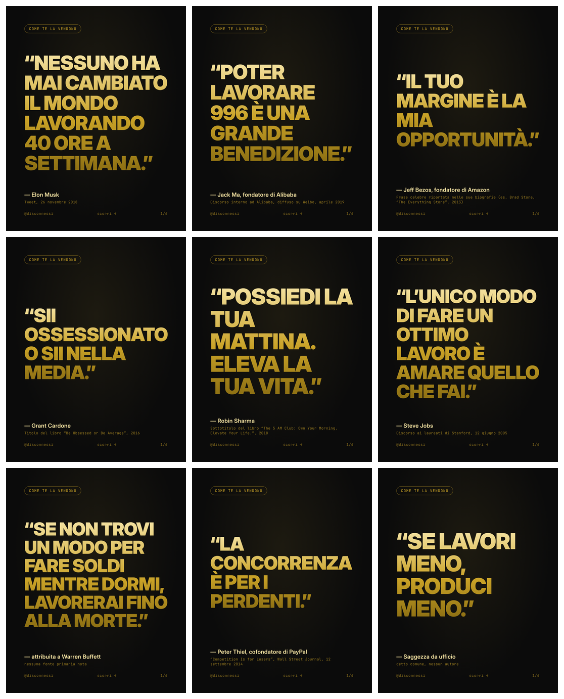
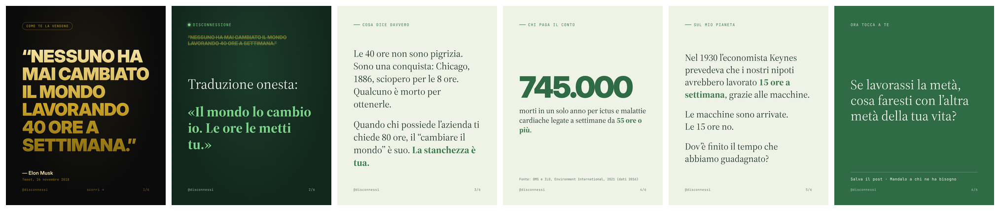

# Disconnessi 🌱

**Un profilo Instagram che prende le frasi motivazionali più virali dei grandi imprenditori e le "disconnette": mostra cosa dicono davvero, chi paga il conto e che alternativa c'è.**

La diagnosi di *Fight Club*, lo sguardo del *Pianeta Verde*.

**Il profilo va in pilota automatico:** un agente scrive i post, verifica le citazioni, pubblica tre volte a settimana, risponde ai commenti e legge le statistiche. Usa solo l'API ufficiale di Instagram. Come funziona e cosa serve per attivarlo: [`docs/06-autopilota.md`](docs/06-autopilota.md).



## Come funziona un post

1. **Slide 1, "come te la vendono":** la citazione in stile motivazionale (nero e oro). Chi segue quei contenuti si ferma.
2. **Slide 2, "disconnessione":** la traduzione onesta, in una riga. Qui il post si ribalta.
3. **Slide 3-5:** cosa dice davvero, un dato su chi paga il conto, lo sguardo di chi viene da un altro pianeta.
4. **Slide 6:** una domanda per chi legge.



## Cosa c'è nel progetto

| Cartella | Cosa trovi |
|---|---|
| [`docs/01-concept.md`](docs/01-concept.md) | L'idea, il tono, nome, bio, colori |
| [`docs/02-format.md`](docs/02-format.md) | Le 7 "ricette" di post e reel che si ripetono |
| [`docs/03-fonti.md`](docs/03-fonti.md) | Libri, idee e dati per argomentare |
| [`docs/04-legale.md`](docs/04-legale.md) | Cosa puoi fare e cosa no (citazioni, foto, diffamazione) |
| [`docs/05-piano-lancio.md`](docs/05-piano-lancio.md) | Il piano dei primi 90 giorni |
| [`docs/06-autopilota.md`](docs/06-autopilota.md) | Il pilota automatico: cosa fa da solo, cosa fai tu, come fermarlo |
| [`post/`](post/) | I post, uno per file, ognuno con il suo stato (bozza, pronto, pubblicato…) |
| [`agente/`](agente/) | L'agente: istruzioni, regole per i commenti, script, diario, cose da fare per te |
| [`contenuti/citazioni.csv`](contenuti/citazioni.csv) | Archivio delle citazioni, con stato della verifica e idee future |
| [`generatore/`](generatore/) | Lo strumento che trasforma i post in immagini |
| `pubblici/` | Le immagini JPEG che l'agente pubblica (create in automatico) |
| `report/` | I report settimanali dell'agente |

## Da dove partire

1. Leggi [`docs/01-concept.md`](docs/01-concept.md) (5 minuti).
2. Scegli il nome dell'account e scrivilo in `generatore/config.json`.
3. Crea il profilo e il token seguendo [`docs/06-autopilota.md`](docs/06-autopilota.md), poi di' a Claude "fatto".
4. Da lì l'agente verifica le fonti, programma i post e parte.

## Creare le immagini

Serve [Node.js](https://nodejs.org) (versione 18 o più recente). La prima volta:

```bash
npm install
```

```bash
npx playwright install chromium
```

Poi, ogni volta che vuoi creare le immagini:

```bash
npm run render
```

Trovi le slide in `output/<nome-post>/` (`01.png`, `02.png`, … più `didascalia.txt` da copiare su Instagram). Per creare un solo post: `npm run render -- 03`.

## Scrivere un nuovo post

Copia un file in `post/` e cambia il testo. La struttura è semplice: ogni slide è separata da `---` e inizia con il suo tipo tra parentesi quadre.

```text
titolo: Il titolo (solo per te)
autore: Chi l'ha detto
fonte: Dove e quando
verifica: cosa controllare prima di pubblicare
hashtag: #mindset #burnout #disconnessi
---
[citazione]
La frase, così come gira online.
---
[disconnessione]
Traduzione onesta:

**«La frase detta con sincerità.»**
---
[testo] Titoletto della slide
Il testo. Le parole tra **due asterischi** diventano verdi e in grassetto.
fonte: se serve, compare in piccolo in basso
---
[dato] Titoletto
745.000
La spiegazione del numero.
fonte: da dove viene il numero
---
[domanda]
La domanda per chi legge.
---
[didascalia]
Il testo da incollare sotto il post (non diventa una slide).
```

Il testo si adatta da solo allo spazio. Se è troppo lungo, il generatore te lo dice.

---

I font inclusi (Inter, Source Serif 4, JetBrains Mono) sono liberi con licenza SIL Open Font License: vedi `generatore/font/`.
